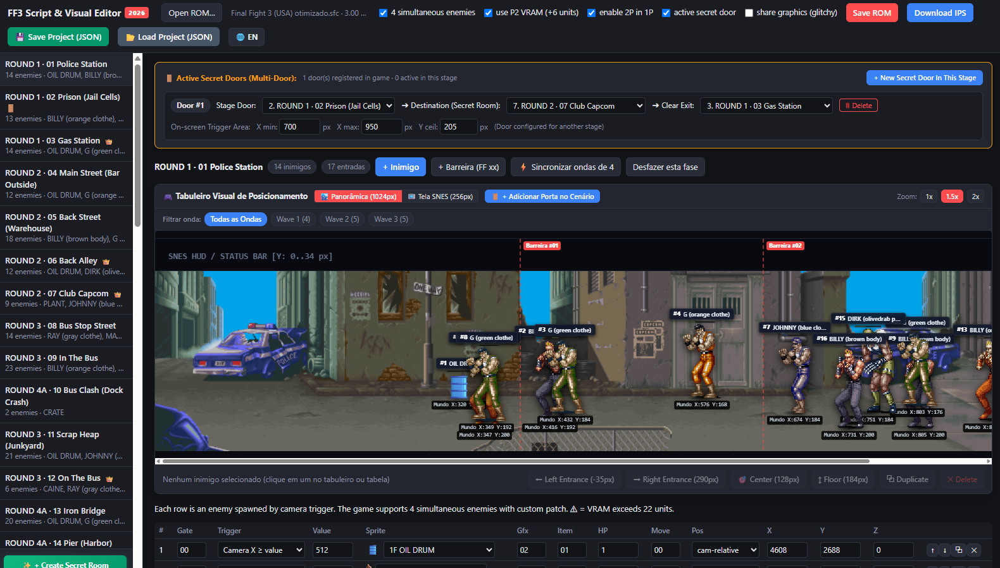

# Final Fight 3 Script & Visual Editor - Manual do Usuário (Português)

  <b>🌐 Idioma / Language:</b>
  <a href="README.md"><b>English (Default README)</b></a> •
  <a href="USAGE_GUIDE.md"><b>English User Guide</b></a>

  

Guia completo de utilização do **Final Fight 3 Script & Visual Editor 2026**. Aprenda como carregar sua ROM, editar ondas de inimigos e chefes de fase, criar portas secretas interativas, clonar cenários e exportar patches.

---

## 1. Início Rápido

1. Dê um duplo-clique no arquivo `FF3_Script_Editor.html` para abri-lo em qualquer navegador de internet moderno (Google Chrome, Microsoft Edge, Firefox, Opera, Safari). Não requer instalação, Node.js ou servidores locais.
2. Clique em **Abrir ROM…** (ou simplesmente arraste e solte o arquivo `Final Fight 3 (USA).sfc` diretamente na janela do navegador).
3. Todas as 42 fases do jogo serão listadas na barra lateral esquerda.
4. Clique em qualquer fase para carregar o cenário visual panorâmico, os sprites dos inimigos e a tabela de propriedades.

> **💡 Dica de Ouro para 60 FPS Sem Quedas de Desempenho:**  
> Antes de começar a editar, recomendamos fortemente aplicar o patch [Final Fight 3 Optimized 1.1 (ROMhacking.net)](https://www.romhacking.net/hacks/8473/) na sua ROM base. Essa otimização elimina os gargalos de processador do SNES original e garante uma taxa cravada de **60 FPS** mesmo com 4 inimigos atacando ao mesmo tempo. Ambos os tipos de ROM (original ou otimizada) são 100% compatíveis com o editor.

---

## 2. Visão Geral da Interface

### Barra Superior (Header)
* **Alternar Idioma (`🌐 EN / PT`)**: Alterne instantaneamente entre Português e Inglês com um único clique.
* **Abrir ROM…**: Abre uma ROM limpa de Super Nintendo (formato `.sfc` ou `.smc`, 3MB).
* **Opções de Patches Automáticos**:
  * **4 inimigos simultâneos**: Libera o 4º slot nos 3 despachadores do jogo.
  * **usar VRAM P2 (+6 unid.)**: Reaproveita os blocos de vídeo do Player 2 para expandir o limite de VRAM de 16 para 22 unidades sem bugs visuais.
  * **liberar 2P no 1P**: Permite que inimigos exclusivos do modo cooperativo apareçam também no modo single player.
  * **porta secreta ativa**: Ativa o motor em código de máquina (65816) de teletransporte em tempo real ao pressionar CIMA na porta.
* **Salvar ROM**: Gera o arquivo `.sfc` com todas as edições e checksum FastROM corrigido.
* **Baixar IPS**: Gera o patch `.ips` para distribuição leve.
* **💾 Salvar Projeto (JSON)**: Exporta todas as suas alterações em um arquivo JSON para continuar editando depois.
* **📂 Carregar Projeto (JSON)**: Restaura todas as suas edições salvas anteriormente em 1 clique.

---

## 3. Edição Visual de Inimigos

### Tabuleiro da Fase (Cenário Interativo)
* **Arrastar e Soltar**: Clique e arraste qualquer inimigo pelo chão da fase.
  * Inimigos comuns ajustam automaticamente sua posição relativa à câmera (`X`).
  * Chefes (`Pos: 1`) ajustam suas coordenadas absolutas no mundo da fase.
* **Alinhamento no Chão (155..215 px)**: O editor avisa em vermelho se um inimigo for colocado muito alto ou muito baixo, evitando que ele fique preso dentro da parede.
* **Atalhos Rápidos**:
  * **⬅ Entrada Esq (-35px)**: Faz o inimigo entrar pela borda esquerda da tela.
  * **➡ Entrada Dir (290px)**: Faz o inimigo entrar pela borda direita da tela.
  * **🎯 Centro (128px)**: Centraliza o inimigo horizontalmente na tela.
  * **↕ Chão (184px)**: Alinha a altura ao centro exato do plano de caminhada.
  * **⧉ Duplicar**: Cria uma cópia idêntica do inimigo selecionado.
  * **✕ Excluir**: Remove o inimigo da fase.

---

## 4. Chefes de Fase e Coordenadas Absolutas

* Os chefes originais (*Dave, Callman, Caine, Drake, Wong, Stray, Black*) utilizam coordenadas de mundo absoluto (`Pos: 1`).
* **👑 Banner do Chefe**:
  * Se o chefe estiver presente na fase, o painel dourado exibirá seu sprite/GIF animado e status.
  * Clique em **🎯 Focar no Chefe** para rolar a tela diretamente até a arena dele.
  * Clique em **+ Inserir Chefe no Cenário** para adicionar um chefe oficial em fases que não possuam.

---

## 5. Portas Secretas e Portais em Tempo Real

* **Criar Porta**: Clique em **+ Nova Porta Secreta Nesta Fase** ou no botão **+ Nova Porta Secreta (Clique & Posicione)** sobre o cenário.
* **Configuração de Rotas**:
  * **Fase da Porta**: Em qual fase a porta está localizada.
  * **➔ Leva para (Sala Secreta)**: Para onde o jogador vai ao entrar na porta.
  * **➔ Ao Vencer, Sair em**: Em qual fase o jogador continua a campanha após vencer a sala secreta.
* **Redimensionamento Interativo**:
  * Arraste as alças brancas laterais para alterar a largura do gatilho (`X min` e `X max`).
  * Arraste a alça superior para ajustar a altura do teto (`Y teto`).
* **No Jogo**: Basta caminhar até a porta e pressionar **CIMA** no direcional para entrar no portal.

---

## 6. Criação da Fase 44 (Sala Secreta Customizada)

1. Clique no botão verde **✨ + Criar Nova Sala Secreta (Fase 44)** no rodapé da barra lateral.
2. Selecione qualquer uma das **43 fases do jogo** para clonar gráficos, paletas de cores e música de fundo.
3. Marque a opção de conectar a porta da cela da prisão e clique em **✨ Confirmar e Criar**.
4. Você pode trocar o tema visual da fase a qualquer momento pelo botão **🔄 Reclonar Cenário Base**.

---

## 7. Salvar e Carregar Projetos (JSON)

* Para não precisar terminar tudo de uma vez, clique em **💾 Salvar Projeto (JSON)** para baixar o arquivo de backup.
* Quando reabrir o editor, basta clicar em **📂 Carregar Projeto (JSON)** (ou arrastar o `.json` para a tela) e todo o seu progresso será restaurado instantaneamente.

