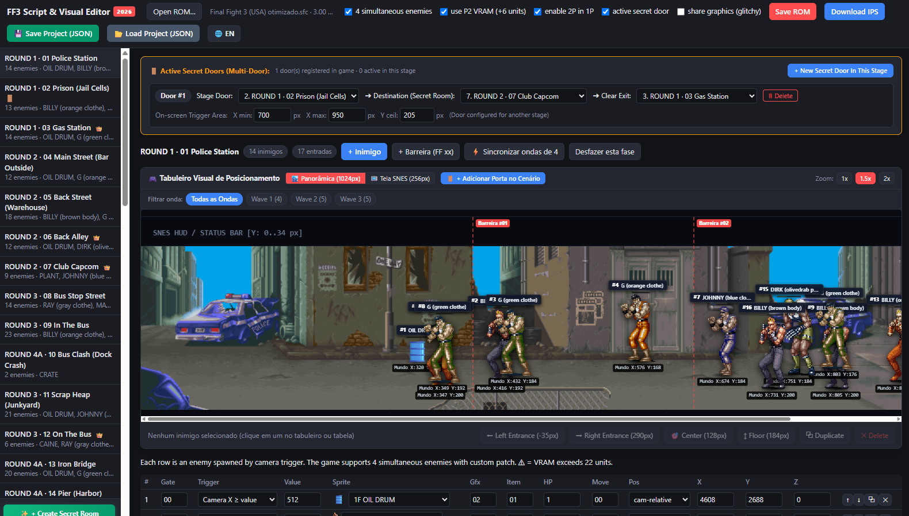

# Final Fight 3 (SNES) - Script & Visual Arena Editor (2026)

[](https://en.wikipedia.org/wiki/Super_Nintendo_Entertainment_System)
[](LICENSE)
[-blue.svg)](#rom-compatibility)
[](#bilingual-support)
[-brightgreen.svg)](#quick-start)

<p align="center">
  <b>🌐 Language / Idioma:</b>
  <a href="README.md"><b>English (Default)</b></a> •
  <a href="MANUAL_DO_USUARIO_PT.md"><b>Português (Manual Completo)</b></a>
</p>

<p align="center">
  
</p>

The **Final Fight 3 Script & Visual Editor 2026** is a comprehensive, browser-based visual suite and ROM hacking tool for **Final Fight 3** on the Super Nintendo Entertainment System (SNES). It features authentic stage panoramas for all 42 stages, real standing pixel-art enemy sprites, an unlocked **4-simultaneous enemies engine patch**, stage boss integration, a **real-time 65816 assembly multi-door portal engine**, custom stage cloning, and full **JSON project save/load** capabilities.

---

## 🌟 Key Highlights

### 1. Visual Stage Arena & Real Pixel-Art Sprites
* **All 42 Stages Mapped**: Full-resolution authentic game background captures (`img/`) with precise playfield geometry (Y: 155..215px walking plane, 0..34px HUD reserve).
* **55 Character Sprite Models**: Integrates authentic enemy sprites (PNG and animated GIFs) from `img/enemies/` for all color variations across Rounds 1, 2, 3, and 4/5/6.
* **Proportional Scaling**: Characters stand on the floor with elliptical drop shadows, health bars, and `#ID Name` tags that scale dynamically with canvas zoom.

### 2. 4-Simultaneous Enemies Engine Patch
* **Spawner Limit Uncapped**: Bypasses the 3-enemy ceiling in Capcom's dispatch routines (`$0070CE`, `$00735E`, `$007542`), freeing Enemy Slot 4 in WRAM (`$0A00-$0AFF`).
* **Player 2 VRAM Reallocation (+6 Units)**: Reclaims unused Player 2 VRAM tiles (`$6600-$6BFF`) as a dedicated sprite expansion block, raising the VRAM ceiling from 16 to **22 units** without tile flickering or graphical corruption.
* **Gate Check Bypass**: Allows 2-Player exclusive enemy spawns to fight in 1-Player mode.

### 3. Stage Boss Support & Absolute Positioning Fix
* **Every Boss Visible & Placeable**: Dave, Callman, Caine, Drake, Wong, Stray, and Black now render at their exact arena coordinates.
* **Absolute Coordinate Math (`Pos: 1`)**: Resolves the legacy bug where absolute world coordinates were pushed off-screen.
* **👑 Boss Banner**: Highlights active bosses with gold crown tags, providing one-click camera focus and a button to insert bosses into any stage.

### 4. Real-time Multi-Door Secret Portals (65816 Assembly Engine)
* **In-Game Trigger**: Pressing **UP** on the D-Pad at any configured door zone triggers an immediate real-time teleport.
* **Interactive Resizing**: Drag handles directly on the canvas to set `X min`, `X max`, and ceiling height `Y ceil`.
* **Flexible Routing**: Configure destination stages and exit stages (where the player resumes campaign progression after clearing the secret room).
* **Default Setup**: Stage 1 starts clean with 0 doors, while the authentic Prison Cell in Stage 2 transports the player to the secret bar (*Club Capcom - Stage 7*).

### 5. Custom Stage 44 Cloning
* **Pure Scenario Inheritance**: Clones video registers, graphics DMA queues, collision maps, and palette tables from any of the 43 game stages.
* **100% Vanilla Audio & Video Stability**: No APU/SPC700 freezes, black screens, or corrupted sound effects.

### 6. Save & Load Project (JSON)
* **Work in Parts**: Export your complete project (enemy placements, waves, health values, secret doors, and patch settings) into a lightweight `.json` backup file.
* **Instant Restore**: Load your project file at any time to resume editing.
* **Drag & Drop**: Drag `.json` project files or `.sfc` ROM files directly onto the browser window.

### 7. Bilingual Interface (English / Portuguese)
* **Default English**: Launches in English by default.
* **1-Click Toggle**: Click the **`🌐 EN / PT`** button in the top bar to toggle between English and Portuguese at any time.

---

## 🚀 Quick Start

1. **No Installation Needed**: Simply open [`FF3_Script_Editor.html`](FF3_Script_Editor.html) in Google Chrome, Microsoft Edge, Mozilla Firefox, Opera, or Safari.
2. Click **Open ROM…** (or drag & drop your `Final Fight 3 (USA).sfc` file into the browser).
3. Select a stage on the sidebar, drag enemies to adjust positions, or edit parameters in the table.
4. Click **Save ROM** to download your patched game file, or **💾 Save Project (JSON)** to save a project backup.

---

## 📁 Repository Structure

```
├── FF3_Script_Editor.html          # Main standalone visual editor application
├── README.md                       # Repository overview and documentation
├── USAGE_GUIDE.md                  # Comprehensive user manual (English)
├── MANUAL_DO_USUARIO_PT.md         # Manual do usuário completo (Português)
├── TECHNICAL_SPECIFICATION.md      # 65816 assembly, memory maps & Capcom bytecode
├── LICENSE                         # MIT Open Source License
├── .gitignore                      # Git ignore configuration
├── img/                            # Stage background panoramas (Stages 1-42)
│   ├── round_1_fase_1.png ... round_5_main_42.png
│   └── enemies/                    # 55 authentic character sprites (PNG & GIF)
│       ├── dave.gif, callman.gif, black_stand.gif ...
│       └── billybrown body.png, andore.png ...
└── scratch/                        # Automated verification test suites
    ├── test_syntax.js
    ├── test_full_suite.js
    ├── test_all_42_stages_and_clean_rom.js
    ├── test_sprite_and_boss_features.js
    └── test_project_import_export_full.js
```

---

## 🛠 ROM Compatibility & Recommended Patch

* **Target Title**: `FINAL FIGHT 3` (SNES, NTSC-USA)
* **File Size**: 3,145,728 bytes (3.0 MB, unheadered `.sfc` or `.smc`)
* **Checksum**: Automatically recalculates and fixes SNES FastROM checksums (`0x00FFDC / 0x00FFDE`) on export.

> [!IMPORTANT]
> ### ⚡ Highly Recommended: Apply "Final Fight 3 Optimized 1.1"
> To achieve the smoothest gameplay experience and eliminate hardware slowdowns with **4 simultaneous enemies on screen**, it is strongly recommended to apply the **Final Fight 3 Optimized (v1.1)** patch to your base ROM:
> 
> * 🔗 **Patch Download**: [Final Fight 3 Optimized 1.1 (ROMhacking.net)](https://www.romhacking.net/hacks/8473/)
> 
> **Why is this important?**  
> Original vanilla Final Fight 3 experiences CPU bottlenecks and slowdowns on real SNES hardware even with just 3 enemies on screen. The *Final Fight 3 Optimized* patch cleans up CPU cycles, refines DMA routines, and optimizes internal loops, allowing the game to run at a consistent **60 FPS** even when 4 enemies and multiple players are engaged in combat simultaneously.
> 
> *(Both vanilla clean ROMs and ROMs pre-patched with Final Fight 3 Optimized 1.1 are 100% compatible with this editor).*

---

## 📖 Additional Documentation

* 📘 [English User Guide](USAGE_GUIDE.md) - Step-by-step instructions for editing enemies, waves, bosses, and doors.
* 📗 [Manual do Usuário em Português](MANUAL_DO_USUARIO_PT.md) - Guia completo em português brasileiro.
* 🔬 [Technical Specification](TECHNICAL_SPECIFICATION.md) - Assembly routines, WRAM pages, VRAM allocations, and scenario pointers.

---

## 📄 License

This project is licensed under the [MIT License](LICENSE).
