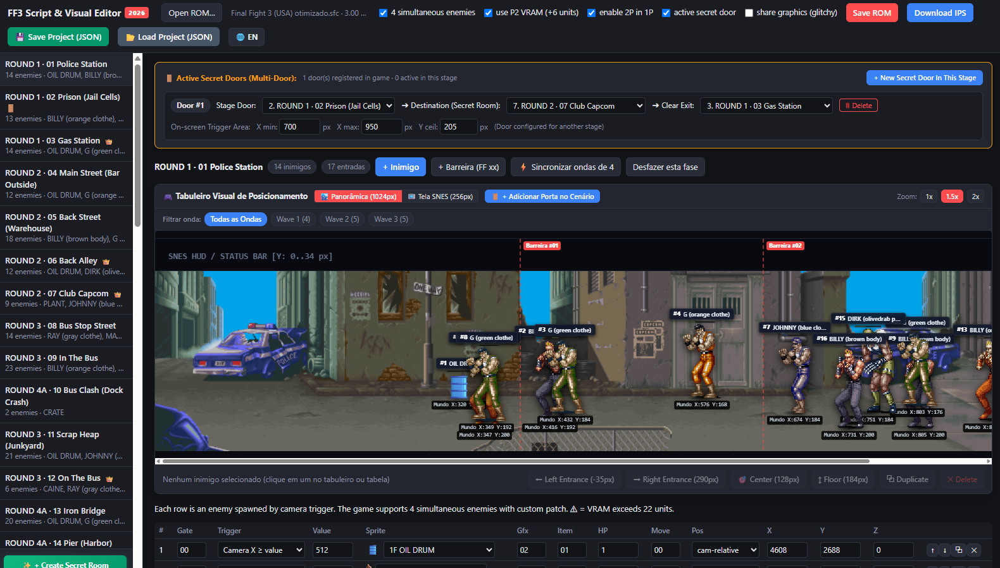

# Final Fight 3 Script & Visual Editor - User Manual (English)

  <b>🌐 Language / Idioma:</b>
  <a href="MANUAL_DO_USUARIO_PT.md"><b>Versão em Português</b></a> •
  <a href="README.md"><b>Main README</b></a>

  

Welcome to the **Final Fight 3 Script & Visual Editor 2026** user guide! This manual explains how to load your ROM, edit enemy waves and stage bosses, create secret doors, clone stages, and export your work.

---

## 1. Quick Start

1. Open `FF3_Script_Editor.html` in any modern web browser (Google Chrome, Microsoft Edge, Firefox, Opera, Safari). No installation, Node.js server, or plugins required.
2. Click **Open ROM…** (or simply drag and drop your `Final Fight 3 (USA).sfc` file into the browser window).
3. The editor immediately lists all 42 stages on the left sidebar.
4. Select any stage to display the visual arena, standing enemy sprites, and data table.

> **💡 Pro-Tip for 60 FPS Performance:**  
> Before editing, we highly recommend applying the [Final Fight 3 Optimized 1.1 patch (ROMhacking.net)](https://www.romhacking.net/hacks/8473/) to your base ROM. This removes SNES CPU lag and guarantees a rock-solid 60 FPS even when 4 enemies are actively attacking at once.

---

## 2. Interface Overview

### Top Toolbar
* **Language Toggle (`🌐 EN / PT`)**: Switch interface between English and Portuguese with one click.
* **Open ROM…**: Select and load an unheadered 3MB Super Nintendo ROM file.
* **Patches Checkboxes**:
  * **4 simultaneous enemies**: Uncaps spawner limit from 3 to 4.
  * **use P2 VRAM (+6 units)**: Reclaims unused Player 2 VRAM tiles to expand enemy sprite budget from 16 to 22 units without glitches.
  * **enable 2P in 1P**: Allows 2-Player exclusive enemies to spawn in single-player mode.
  * **active secret door**: Activates the real-time 65816 assembly portal engine.
* **Save ROM**: Downloads the modified `.sfc` ROM with automatically calculated FastROM checksums.
* **Download IPS**: Exports an IPS patch file comparing your edits against the clean ROM.
* **💾 Save Project (JSON)**: Saves all stage enemies, positions, secret doors, and settings into a JSON backup file.
* **📂 Load Project (JSON)**: Restores all your work in one click, allowing incremental stage editing.

---

## 3. Editing Enemies & Stages

### Visual Stage Canvas
* **Drag & Drop**: Click and drag any enemy token across the stage arena.
  * Grunt enemies update their relative screen offset (`X`) automatically.
  * Bosses (`Pos: 1`) update their exact absolute world arena coordinates.
* **Floor Alignment (155..215px)**: The editor warns if an enemy is placed too high (`Y < 155px`) or too low (`Y > 215px`) to prevent enemies getting stuck inside walls.
* **Selection Bar Shortcuts**:
  * **⬅ Left Entrance (-35px)**: Place enemy to walk into screen from the left.
  * **➡ Right Entrance (290px)**: Place enemy to walk into screen from the right.
  * **🎯 Center (128px)**: Place enemy in center of screen.
  * **↕ Floor (184px)**: Snap height to the authentic walking plane.
  * **⧉ Duplicate**: Duplicate the selected enemy with identical stats.
  * **✕ Delete**: Remove selected enemy.

### Enemy Properties Table
* **Gate**: `0` = Always spawn; `1` = Spawn only if 2-Player mode is active.
* **Trigger**: Camera threshold mode (e.g. `Camera X ≥ value`, `Immediate`).
* **Value**: Camera trigger position (in 1/16th pixels).
* **Sprite**: Choose from all 55 authentic pixel art sprites and palette swaps (Round 1, 2, 3, 4/5/6).
* **HP**: Health points (Grunts: 30-48, Bosses: 90-140).
* **Pos**: `cam-relative` (regular enemies) or `absolute` (bosses).

---

## 4. Stage Bosses & Absolute Coordinates

* In Final Fight 3, stage bosses (*Dave, Callman, Caine, Drake, Wong, Stray, Black*) use absolute world coordinates (`Pos: 1`).
* **👑 Boss Banner**:
  * When a boss is present in the arena, the gold boss banner appears above the stage canvas.
  * Click **🎯 Focus on Boss** to scroll the camera directly to their arena location.
  * Click **+ Insert Boss into Stage** to place the official boss into any stage that currently lacks one.

---

## 5. Secret Doors (Multi-Door System)

* **Adding Doors**: Click **+ New Secret Door in This Stage** or **+ New Secret Door (Click & Place)** on the canvas.
* **Configuring Routes**:
  * **Stage Door**: Stage where the door trigger is physically located.
  * **Destination**: Target secret stage (e.g. Stage 7 Club Capcom or Stage 44).
  * **Clear Exit**: Stage where the player emerges upon defeating the secret arena.
* **Interactive Resizing**:
  * Drag the left handle `[ ]` to change `X min`.
  * Drag the right handle `[ ]` to change `X max`.
  * Drag the top handle to change ceiling height `Y ceil`.
* **In-Game Trigger**: Walking up to the door and pressing **UP** on the D-Pad triggers the instant teleport transition.

---

## 6. Creating Custom Secret Rooms (Stage 44)

1. Click **✨ + Create Secret Room (Stage 44)** at the bottom of the sidebar.
2. Select any of the **43 stages** to clone graphics, color palettes, and background music.
3. Check **Clone all original enemies** (common enemies auto-align to the floor) and **Connect Prison Cell Door (Stage 2)**.
4. Click **✨ Confirm and Create**.
5. You can re-clone the visual theme anytime using the **🔄 Re-clone Base Stage** button.

---

## 7. Saving and Backing Up Projects (JSON)

* You don't need to finish your entire hack in a single sitting!
* Click **💾 Save Project (JSON)** to download a `.json` backup file.
* Next time you open the editor, click **📂 Load Project (JSON)** (or drag the `.json` file into the browser window).
* All your enemy placements, health tweaks, custom waves, and secret doors are completely restored.

